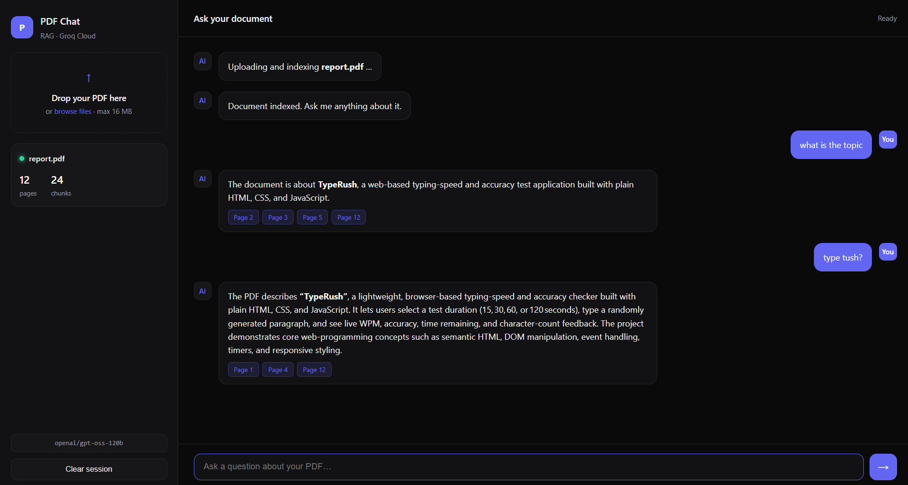

# PDF-RAG: Intelligent Document Assistant

PDF-RAG is a high-performance Retrieval-Augmented Generation (RAG) system that allows you to "chat" with your PDF documents. By combining lightning-fast LLM inference via Groq with efficient local vector search using FAISS, it provides instant, context-aware answers grounded strictly in your uploaded content.



## 🚀 Features

- **Instant PDF Processing**: Extract and index text from large PDFs in seconds.
- **Semantic Search**: Uses FAISS and Sentence Transformers (`all-MiniLM-L6-v2`) to find the most relevant context for your questions.
- **Ultra-Fast AI**: Powered by Groq Cloud LPU™ inference for near-instant responses.
- **Citations & Sources**: Every answer includes the specific page numbers where the information was found.
- **Clean UI**: A modern, dark-themed interface with drag-and-drop support.
- **Session Memory**: Remembers recent conversation history for follow-up questions.

## 🛠️ Tech Stack

- **Backend**: Python, Flask
- **AI/ML**: Groq Cloud API, FAISS (Facebook AI Similarity Search), Sentence-Transformers
- **Parsing**: PyMuPDF (fitz)
- **Frontend**: HTML5, CSS3, Vanilla JavaScript

## 📋 Prerequisites

- Python 3.9+
- A Groq Cloud API Key (Get it at [console.groq.com](https://console.groq.com/))

## ⚙️ Installation

1. **Clone the repository**:
   ```bash
   git clone <repository-url>
   cd pdf-rag
   ```

2. **Install dependencies**:
   ```bash
   pip install -r requirements.txt
   ```

3. **Configure Environment Variables**:
   Create a `.env` file in the root directory (or edit the existing one):
   ```env
   GROQ_API_KEY=your_api_key_here
   GROQ_MODEL=openai/gpt-oss-120b
   SECRET_KEY=your-random-secret-key
   ```

## 🏃 Running the App

1. Start the Flask server:
   ```bash
   python app.py
   ```
2. Open your browser and navigate to `http://127.0.0.1:5000`.

## 📂 Project Structure

- `app.py`: Main Flask application and API endpoints.
- `config.py`: Configuration settings and environment variable loading.
- `services/`:
  - `pdf_service.py`: PDF text extraction logic.
  - `chunk_service.py`: Text splitting and chunking strategy.
  - `embedding_service.py`: Local vector embedding generation.
  - `vector_service.py`: FAISS index management and similarity search.
  - `groq_service.py`: Groq LLM integration.
- `static/`: Frontend assets (CSS, JS).
- `templates/`: HTML templates.

## 📝 License

This project is created for educational purposes as part of the MCA "AI Tools" subject at Chandigarh University.
